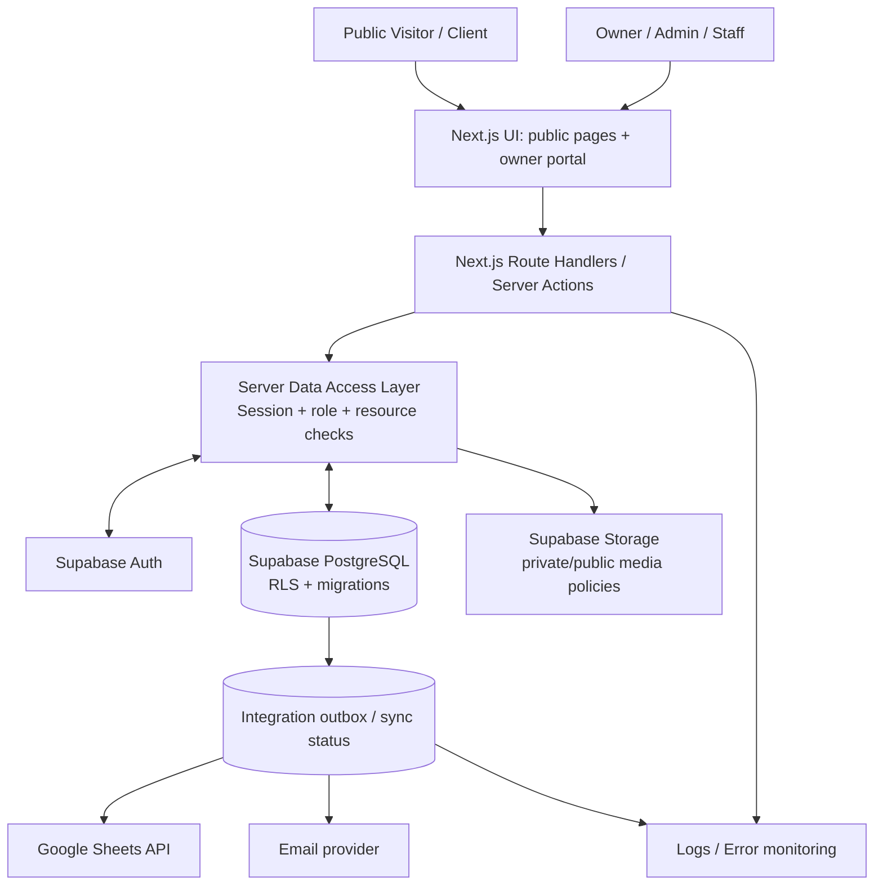
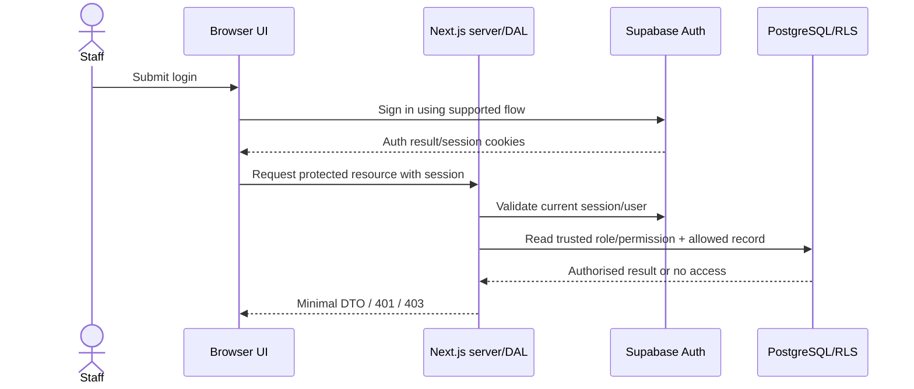
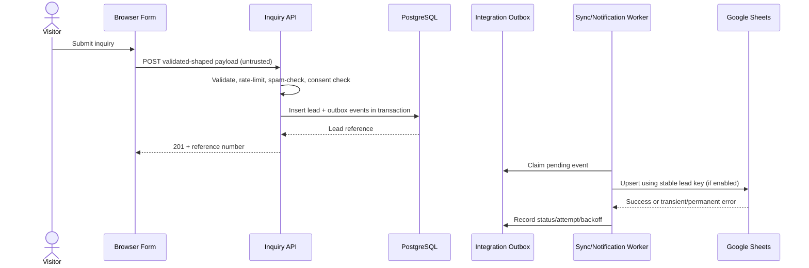

# System Architecture — The HookMedia

## 1. Architecture goals
- Small enough to operate with a lean agency team.
- Clear public/internal trust boundary.
- One primary datastore for operational records.
- Centralised server-side authorisation.
- Optional integrations with retryable delivery.
- Easy to test and deploy.

## 2. Logical architecture


## 3. Proposed deployment
- One Next.js codebase for public pages and internal owner portal.
- Vercel deployment with preview deployments for non-production branches.
- Supabase separate projects for development/staging and production where feasible.
- Database schema managed through reviewed SQL migrations in Git.
- Google Sheets and email credentials configured separately per environment.
- Production service-role/secret key is available only to server-only modules; browser build must not contain it.

## 4. Trust boundaries
1. **Anonymous browser → public API:** untrusted. Apply validation, rate limits, spam checks and output shaping.
2. **Authenticated staff browser → server:** session is not sufficient by itself; validate required role and resource access per operation.
3. **Server → database:** use user-scoped clients and RLS for ordinary access. Any privileged client must be server-only, minimally used, and guarded by explicit server-side checks.
4. **Server → external provider:** send only required fields, set timeouts, handle rate limits and avoid leaking secrets in logs.
5. **Uploaded file → storage:** validate extension, MIME/magic bytes where available, size and access policy; never trust client-provided MIME alone.

## 5. Recommended code layout
```text
src/
  app/
    (public)/
      page.tsx
      services/
      work/
      about/
      blog/
      contact/
      privacy/
      terms/
    owner/
      login/
      dashboard/
      leads/
      clients/
      projects/
      tasks/
      services/
      portfolio/
      blog/
      quotations/
      settings/
    api/
      public/inquiries/route.ts
      owner/leads/route.ts
      owner/leads/[id]/route.ts
      owner/clients/route.ts
      owner/projects/route.ts
      owner/tasks/route.ts
      integrations/google-sheets/sync/route.ts
  components/
  lib/
    auth/
    dal/
    validation/
    db/
    integrations/
    logging/
    security/
  types/
  styles/
supabase/
  migrations/
  tests/
docs/
```
Use the existing repository structure if it already has a consistent architecture; do not rewrite it without a clear reason.

## 6. Authentication and authorisation request sequence

Do not trust a role sent in a form, URL, localStorage or user-editable metadata. For high-risk operations, re-check current role/permission from trusted server/database state.

## 7. Inquiry processing sequence

The sync worker can initially be a protected scheduled/server job or manually triggered owner action. For serverless environments, do not rely on an in-memory process that may terminate after a request. Use an actual durable queue/scheduled mechanism suitable for the hosting plan.

## 8. Data access principles
- Use DTOs (Data Transfer Objects) to return only needed fields.
- Put role/resource checks in reusable DAL functions, not scattered only in page components.
- Enforce RLS on tables accessible through Supabase's exposed API schemas.
- Separate server-only integration code from client modules, and use import boundaries/build checks where practical.
- Prefer narrowly scoped database functions for privileged operations instead of general-purpose arbitrary SQL endpoints.
- Paginate collections and cap page size.
- Use transactions for linked writes such as lead-to-client conversion and lead plus outbox creation.

## 9. Observability
Every server request should carry a request/correlation ID. Record structured event fields such as timestamp, route, outcome, latency, and safe internal record ID. Do not log passwords, access tokens, service keys, full inquiry descriptions or more personal data than needed.

## 10. Architecture risks and mitigations
- **Overusing service role:** restrict to server-only module; explicit authorization; audit; tests.
- **Spreadsheet drift:** DB is source of truth; stable key/upsert; retry status and reconciliation.
- **Single application becoming large:** modular route/domain structure; split only when actual scaling/team needs justify it.
- **RLS mistakes:** migration review, positive/negative RLS tests for every data class.
- **Slow dashboard:** indexed filters, pagination, aggregate views/functions tested for permission leakage.
- **Secrets in preview deployments:** separate env vars/projects, branch protection, production secret scoping.
