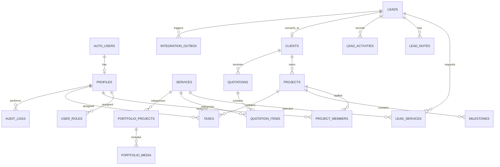

# Database Design and Data Dictionary

## 1. Principles
- PostgreSQL is the source of truth.
- Use UUID primary keys for domain records; use a separate public reference for inquiry confirmation.
- Use `timestamptz` for timestamps stored in UTC; render in configured business timezone.
- Use `numeric(p,s)` for monetary fields, never floating-point for currency.
- Use foreign keys, uniqueness constraints and explicit deletion behaviour.
- Keep database migrations versioned and reviewed.
- Enable RLS on exposed tables and test both allowed and denied operations.

## 2. High-level ER diagram

`AUTH_USERS` is managed by Supabase Auth. Do not recreate password storage in application tables.

## 3. Recommended entities
### `profiles`
- `user_id UUID PK FK -> auth.users(id) ON DELETE RESTRICT` (or managed deactivation policy)
- `display_name TEXT NOT NULL`
- `work_email TEXT` (unique if stored and normalised)
- `avatar_path TEXT NULL`
- `is_active BOOLEAN NOT NULL DEFAULT true`
- `created_at`, `updated_at TIMESTAMPTZ NOT NULL`

Purpose: non-secret application profile fields. Do not store password hashes, tokens or provider credentials.

### `user_roles`
- `id UUID PK`
- `user_id UUID FK -> auth.users(id)`
- `role TEXT CHECK IN ('owner','admin','project_manager','editor','designer','developer','marketing_specialist')`
- `granted_by UUID NULL FK -> auth.users(id)`
- `granted_at TIMESTAMPTZ NOT NULL DEFAULT now()`
- `revoked_at TIMESTAMPTZ NULL`
- Unique/partial constraint for one active assignment per user/role as required.

Restrict all writes. Role changes require trusted server-side permission checks and audit records. Prevent removing the last active owner without an explicit break-glass procedure.

### `services`
- `id UUID PK`, `name TEXT NOT NULL`, `slug TEXT UNIQUE NOT NULL`
- `category_id UUID FK`, `short_description TEXT`, `body_content JSONB/TEXT`
- `deliverables JSONB`, `starting_price NUMERIC(12,2) NULL`, `currency CHAR(3) DEFAULT 'INR'`
- `duration_label TEXT NULL`, `cover_asset_path TEXT NULL`
- `status TEXT CHECK IN ('draft','published','archived')`
- `seo_title TEXT`, `seo_description TEXT`, `published_at TIMESTAMPTZ NULL`
- `created_by`, `updated_by` UUID, timestamps

### `service_categories`
- `id UUID PK`, `name TEXT`, `slug TEXT UNIQUE`, `sort_order INT`, `status TEXT`

### `leads`
- `id UUID PK`
- `public_reference TEXT UNIQUE NOT NULL` (random, non-sequential)
- `full_name TEXT NOT NULL`, `email_normalized TEXT NOT NULL`, `phone TEXT NULL`
- `company_name TEXT NULL`, `website_url TEXT NULL`, `industry TEXT NULL`
- `project_description TEXT NOT NULL`, `budget_band TEXT NULL`, `timeline TEXT NULL`
- `preferred_contact_method TEXT NULL`, `source TEXT NOT NULL DEFAULT 'website'`
- `status TEXT CHECK IN ('new','contacted','qualified','proposal_sent','negotiation','won','lost') DEFAULT 'new'`
- `assigned_to UUID NULL FK -> auth.users(id)`
- `follow_up_at TIMESTAMPTZ NULL`, `consent_version TEXT NULL`, `consented_at TIMESTAMPTZ NULL`
- `converted_client_id UUID NULL` (or use client.source_lead_id to avoid circular design)
- `created_at`, `updated_at TIMESTAMPTZ NOT NULL`

Do not store internal notes on the public submission payload row. Do not use IP address as a business identifier. If abuse telemetry requires it, define minimisation and retention explicitly.

### `lead_services`
- `lead_id UUID FK -> leads(id) ON DELETE CASCADE`
- `service_id UUID FK -> services(id)`; also consider a safe snapshot label if service catalogue may change
- Composite primary key `(lead_id, service_id)`

### `lead_notes`
- `id UUID PK`, `lead_id UUID FK`, `body TEXT NOT NULL`
- `created_by UUID FK`, `created_at TIMESTAMPTZ`
- `visibility TEXT DEFAULT 'internal' CHECK (visibility='internal')`

Only trusted staff can read/write. Public DTOs must never include this table.

### `lead_activities`
- `id UUID PK`, `lead_id UUID FK`, `actor_user_id UUID NULL`
- `activity_type TEXT NOT NULL`, `summary TEXT NOT NULL`, `metadata JSONB` (allowlist values; no secrets)
- `created_at TIMESTAMPTZ NOT NULL`

Use for meaningful pipeline transitions and follow-up history; `audit_logs` remains the security-sensitive record.

### `clients`
- `id UUID PK`, `name TEXT NOT NULL`, `email_normalized TEXT NULL`, `phone TEXT NULL`
- `company_name TEXT NULL`, `website_url TEXT NULL`, `status TEXT`
- `source_lead_id UUID UNIQUE NULL FK -> leads(id)`
- `created_at`, `updated_at TIMESTAMPTZ`

Define a duplicate-detection policy; an email match is a hint, not always proof that two people are the same client. Use a transaction during conversion.

### `projects`
- `id UUID PK`, `client_id UUID FK -> clients(id)`
- `name TEXT NOT NULL`, `slug TEXT NULL`, `description TEXT NULL`, `service_category TEXT NULL`
- `status TEXT CHECK IN ('planning','in_progress','in_review','client_feedback','completed','on_hold','cancelled')`
- `priority TEXT CHECK IN ('low','normal','high','urgent')`
- `start_date DATE NULL`, `due_date DATE NULL`
- `budget_amount NUMERIC(12,2) NULL`, `currency CHAR(3) DEFAULT 'INR'`
- `created_by UUID`, timestamps, `archived_at TIMESTAMPTZ NULL`

### `project_members`
- `project_id UUID FK`, `user_id UUID FK`, `project_role TEXT NULL`, `added_by UUID`, `created_at`
- Composite unique `(project_id,user_id)`.

### `milestones`
- `id UUID PK`, `project_id UUID FK`, `name TEXT`, `description TEXT NULL`
- `status TEXT`, `due_date DATE NULL`, `completed_at TIMESTAMPTZ NULL`, timestamps

### `tasks`
- `id UUID PK`, `project_id UUID FK`, `milestone_id UUID NULL FK`
- `title TEXT NOT NULL`, `description TEXT NULL`
- `status TEXT CHECK IN ('todo','in_progress','review','done')`
- `priority TEXT CHECK IN ('low','normal','high','urgent')`
- `assignee_user_id UUID NULL FK -> auth.users(id)`
- `due_at TIMESTAMPTZ NULL`, `completed_at TIMESTAMPTZ NULL`
- `created_by UUID`, timestamps

### `portfolio_projects` and `portfolio_media`
Portfolio project fields: `id`, `title`, `slug UNIQUE`, `summary`, `body_content`, `category`, `technologies JSONB`, `verified_outcomes JSONB NULL`, `status`, SEO fields, `published_at`, timestamps. Media fields: `id`, `portfolio_project_id`, `storage_path/approved_external_url`, `media_type`, `alt_text`, `sort_order`. Public media URLs should be safe and intentional; private client project files must not use public bucket permissions.

### `blog_posts`, `faqs`, `testimonials`, `site_settings`
- Blog: title, unique slug, summary, safe body format, category, tags, author, status, SEO fields, published_at.
- FAQ: question, answer, sort_order, status.
- Testimonial: quote, displayed_name/title/company only with permission, source/consent evidence as required, status.
- Site settings: allowlisted keys + typed values. Do not use this table as a generic secret store.

### `quotations` and `quotation_items`
- Quotation: `id`, `quotation_number UNIQUE`, `client_id`, optional `lead_id`, `status`, `currency`, `subtotal NUMERIC(12,2)`, `discount_amount NUMERIC(12,2)`, `tax_amount NUMERIC(12,2)`, `total NUMERIC(12,2)`, `scope_text`, `terms_text`, `valid_until DATE`, `created_by`, timestamps.
- Item: `id`, `quotation_id`, optional `service_id`, description snapshot, `quantity NUMERIC(12,3)`, `unit_price NUMERIC(12,2)`, `line_total NUMERIC(12,2)`, sort_order.

Totals are calculated/validated on the server and, where appropriate, inside a transaction. This module does not equal tax or accounting compliance.

### `audit_logs`
- `id UUID PK`, `actor_user_id UUID NULL`, `action TEXT`, `resource_type TEXT`, `resource_id UUID/TEXT NULL`
- `outcome TEXT`, `request_id TEXT NULL`, `safe_metadata JSONB`, `created_at TIMESTAMPTZ`

Append-only to application roles. Avoid storing complete record snapshots or personal data unless justified.

### `integration_outbox`
- `id UUID PK`, `event_type TEXT`, `entity_type TEXT`, `entity_id UUID`, `destination TEXT`
- `idempotency_key TEXT UNIQUE NOT NULL`, `payload_version INT NOT NULL`, `payload JSONB`
- `status TEXT CHECK IN ('pending','processing','succeeded','retryable_failure','permanent_failure')`
- `attempt_count INT DEFAULT 0`, `next_attempt_at TIMESTAMPTZ`, `last_error_code TEXT NULL`, `created_at`, `updated_at`, `processed_at TIMESTAMPTZ NULL`

Keep payloads minimal. Consider referencing entity IDs and constructing the current approved payload at send time to avoid duplicating sensitive content.

## 4. Index recommendations
- `leads(created_at DESC)`, `leads(status, created_at DESC)`, `leads(assigned_to, status)`, `leads(follow_up_at)`
- Normalised lead email index if operationally useful; assess privacy and query requirements.
- `projects(client_id, status)`, `projects(due_date)`, `tasks(assignee_user_id, status, due_at)`, `tasks(project_id, status)`
- `portfolio_projects(status, published_at DESC)`, `blog_posts(status, published_at DESC)`
- `integration_outbox(status, next_attempt_at)`
- Index FK columns used in RLS predicates/joins.

Verify index use with real query plans before adding every optional index.

## 5. Migration and RLS workflow
1. Write SQL migration.
2. Review grants, RLS policies, functions and indexes.
3. Apply to development database.
4. Run schema tests and role-switching/RLS tests.
5. Apply to staging using the same migration artifact.
6. Back up production before high-risk changes.
7. Apply approved migration and verify post-deploy checks.

Avoid manual production schema changes that are not captured in version control.
